 

  

### QA AUTOMATION · SOFTWARE ENGINEERING · AI-DRIVEN QA

**Building reliable software. Testing with confidence. Delivering quality.**

*Software quality is not an afterthought. It is part of how software is designed, built, and delivered.*

---

## 👨‍💻 About Me | Sobre mí

### 🇪🇸 Español

Soy Jhoann Acosta, conocido como **Blazkull**, profesional de ingeniería de software enfocado en **QA Automation, desarrollo web e integración de soluciones digitales**. También impulso proyectos mediante KoompaDigital.

Me interesa construir software confiable, automatizar procesos de validación y desarrollar aplicaciones que resuelvan problemas reales. Combino pruebas E2E, testing de APIs, desarrollo backend y frontend, métricas de calidad y proyectos de integración entre software y hardware.

Mi enfoque es conectar el desarrollo con la calidad: crear funcionalidades y establecer procesos reproducibles para verificar que funcionan correctamente.

### 🇬🇧 English

I'm Jhoann Acosta, known as **Blazkull**, a software engineering professional focused on **QA Automation, web development, and digital solutions**. I also build projects through KoompaDigital.

I work on reliable software, automated validation workflows, and applications that solve real-world problems. My interests include end-to-end testing, API testing, frontend and backend development, quality metrics, and hardware–software integration.

My goal is to connect engineering with quality by building features and establishing repeatable processes to verify that they work as expected.

---

## 🎯 What I Do | En qué trabajo

<table>
<tr>
<td width="50%" valign="top">

### 🧪 QA Automation

- End-to-end testing with Cypress and Playwright.
- TypeScript and JavaScript test automation.
- BDD with Cucumber and Gherkin.
- API testing with Postman.
- Page Object Model (POM).
- Reusable test architecture.
- AI-assisted testing workflows.

</td>
<td width="50%" valign="top">

### 💻 Software Development

- Responsive web applications.
- React and Next.js.
- Python and FastAPI.
- REST API development.
- SQL, MySQL and PostgreSQL.
- Event websites and RSVP platforms.
- Business and academic applications.

</td>
</tr>
<tr>
<td width="50%" valign="top">

### 📊 Quality Engineering

- QA metrics and reporting.
- Validation workflows and traceability.
- Test documentation.
- Test coverage and defect analysis.
- Repeatable quality checks.
- AI-driven QA experimentation.

</td>
<td width="50%" valign="top">

### 🔌 IoT & Integration

- ESP32 and Arduino projects.
- Hardware–software integration.
- Connected applications.
- System integration.
- Automation and technical experimentation.

</td>
</tr>
</table>

---

## 🛠️ Tech Stack | Tecnologías

**QA Automation & API Testing**

**Frontend & Backend**

**Databases, IoT & Tools**

# 🚀 Portfolio | Portafolio

Selected websites and software projects. Each preview uses an image stored in this repository.

*Sitios web y proyectos de software seleccionados. Cada vista previa utiliza una imagen almacenada en este repositorio.*

## 🏢 Business & Organization Websites | Sitios corporativos

<table>
<tr>
<td width="50%" valign="top">

### Marpin Constructora

<a href="https://constructoramarpin.com/">
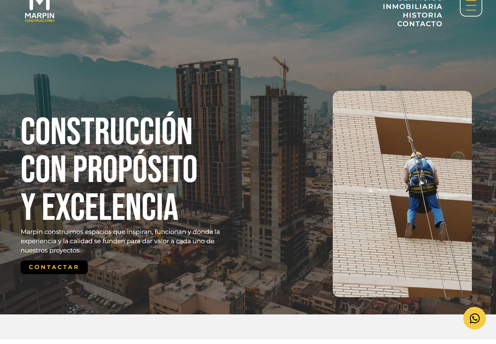
</a>

Corporate website for a construction business.

[Visit website ↗](https://constructoramarpin.com/)

</td>
<td width="50%" valign="top">

### CBINT

<a href="https://cbint.org/">
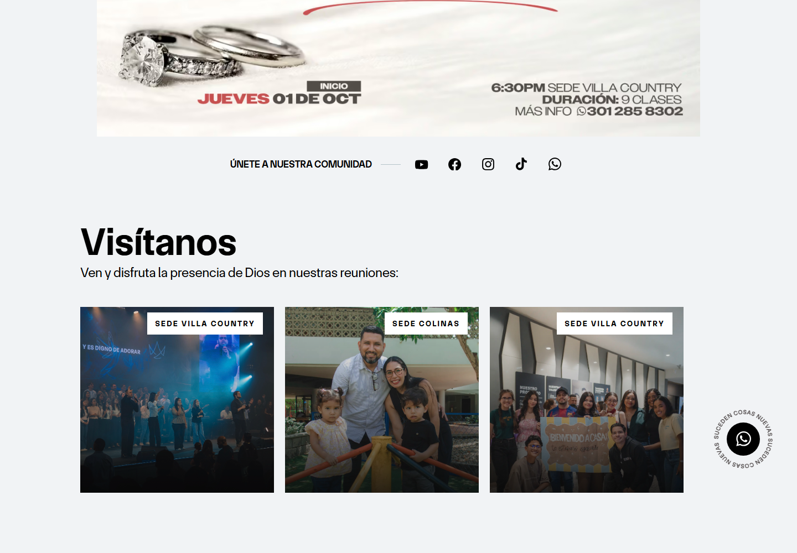
</a>

Organizational website and digital presence.

[Visit website ↗](https://cbint.org/)

</td>
</tr>
<tr>
<td width="50%" valign="top">

### Lumina Digital

<a href="https://www.luminadigital.com.co/">
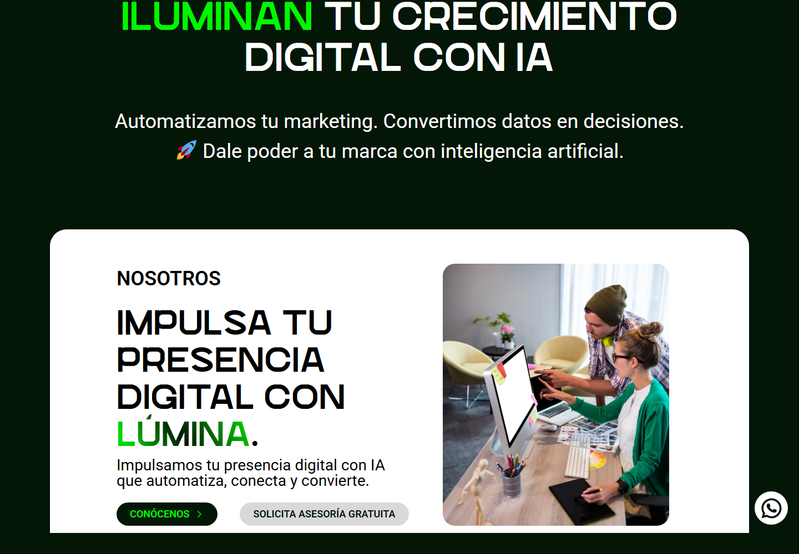
</a>

Digital services and web experiences.

[Visit website ↗](https://www.luminadigital.com.co/)

</td>
<td width="50%" valign="top">

### KoompaDigital

Digital solutions and web development.

[Visit website ↗](https://koompadigital.com/)

</td>
</tr>
</table>

## 💍 Event Websites | Sitios para eventos

Digital invitations, wedding websites, and personalized event experiences.

*Invitaciones digitales, sitios de bodas y experiencias personalizadas para eventos.*

<table>
<tr>
<td width="50%" valign="top">

### Veronica & Steven 2027

<a href="https://veronicaandsteven2027.com/welcome">
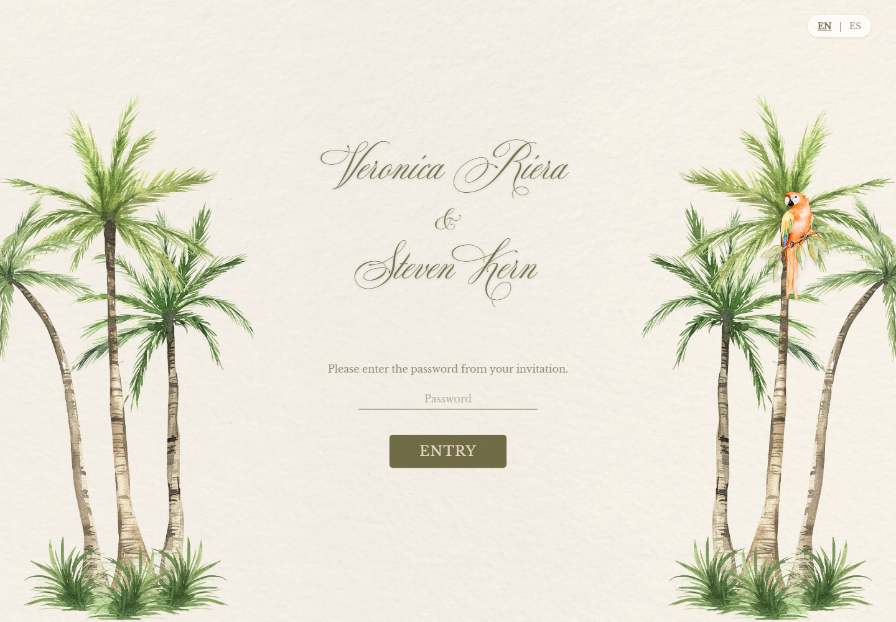
</a>

Wedding website and invitation experience.

[Visit website ↗](https://veronicaandsteven2027.com/welcome)

</td>
<td width="50%" valign="top">

### Mafe & Maxwell

<a href="https://mafeandmaxwell.com/">
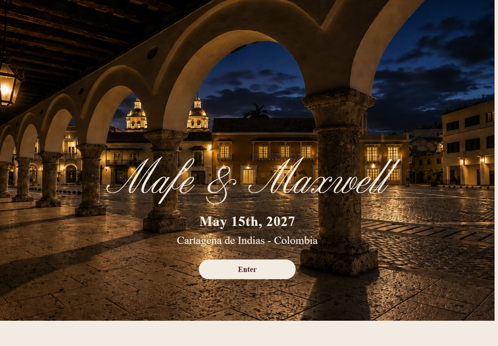
</a>

Personalized wedding website.

[Visit website ↗](https://mafeandmaxwell.com/)

</td>
</tr>
<tr>
<td width="50%" valign="top">

### Noche de las Estrellas Goya

<a href="https://nochedelasestrellasgoya.com/">
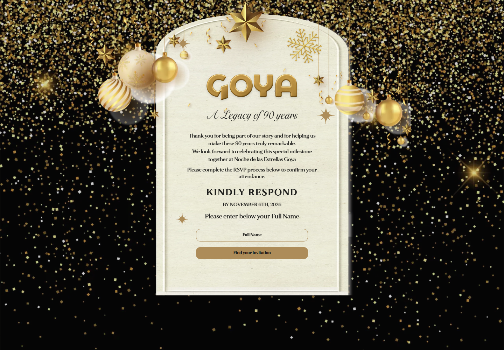
</a>

Celebration and event website.

[Visit website ↗](https://nochedelasestrellasgoya.com/)

</td>
<td width="50%" valign="top">

### George & Carlos

<a href="https://georgeandcarlos.com/">
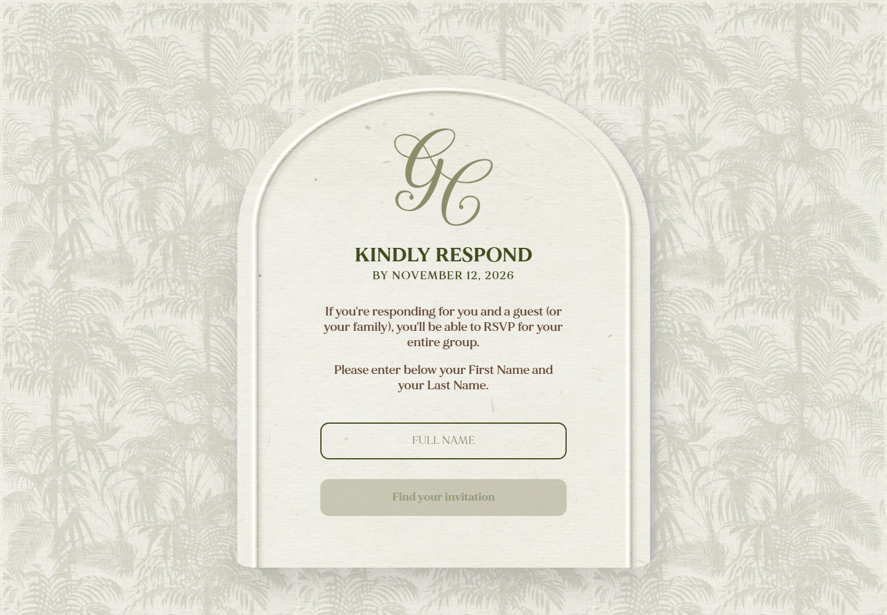
</a>

Wedding website and digital invitation.

[Visit website ↗](https://georgeandcarlos.com/)

</td>
</tr>
<tr>
<td width="50%" valign="top">

### Julianna & Benjamin

<a href="https://juliannaandbenjamin.com/">
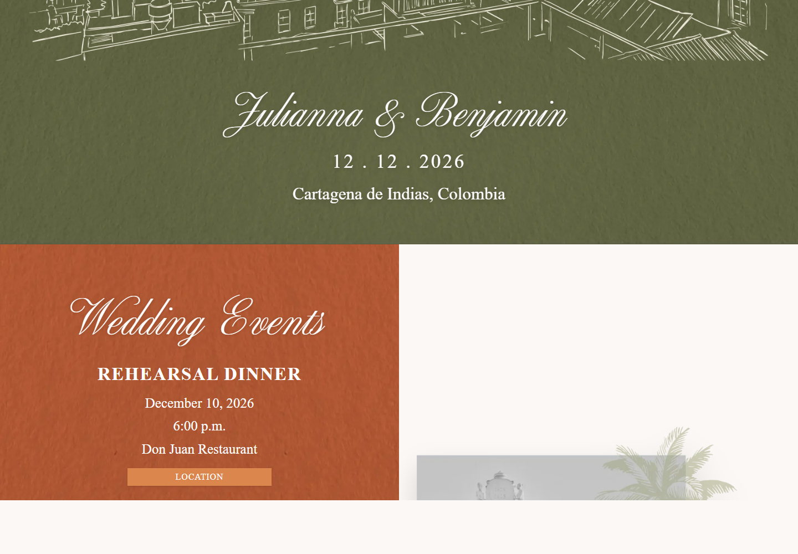
</a>

Personalized wedding website.

[Visit website ↗](https://juliannaandbenjamin.com/)

</td>
<td width="50%" valign="top">

### Will You Marry Me

<a href="https://wellsyoumarryme.com/">
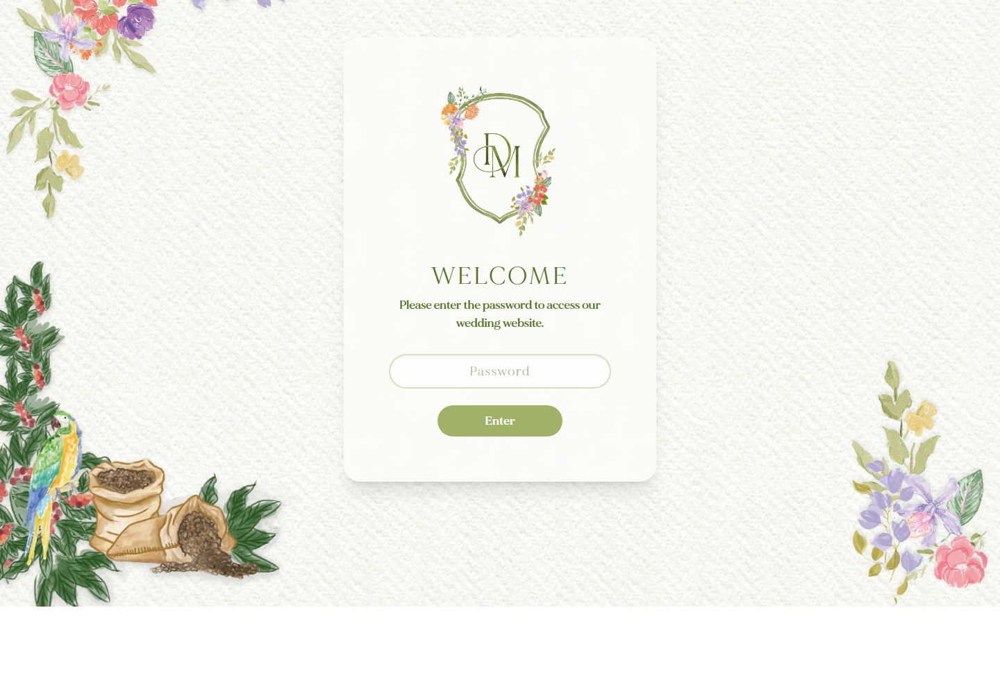
</a>

Proposal and event experience.

[Visit website ↗](https://wellsyoumarryme.com/)

</td>
</tr>
<tr>
<td width="50%" valign="top">

### Juan & Ronny

<a href="https://juanronnywedding.com/">
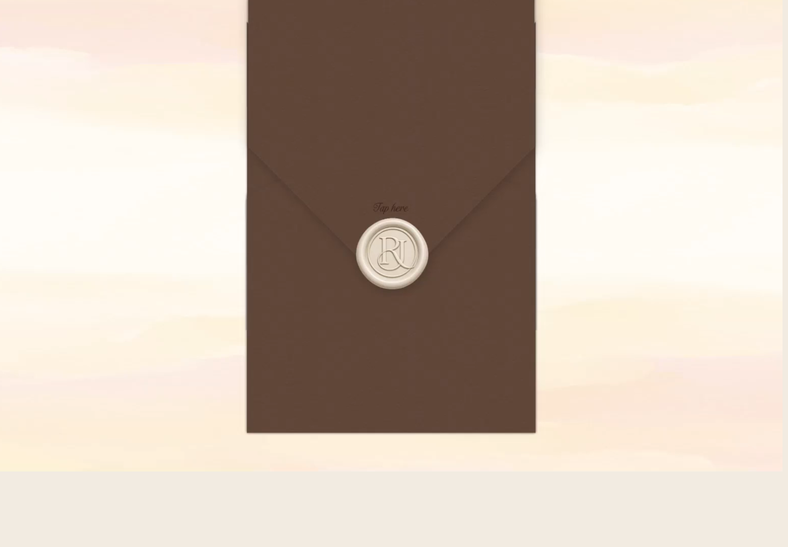
</a>

Personalized wedding website.

[Visit website ↗](https://juanronnywedding.com/)

</td>
<td width="50%" valign="top">

### Los 50 de Adriana

<a href="https://los50deadriana.com/">
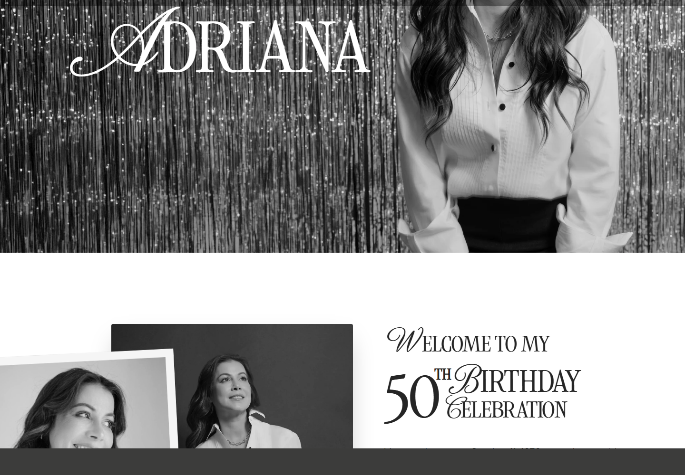
</a>

Birthday celebration website.

[Visit website ↗](https://los50deadriana.com/)

</td>
</tr>
<tr>
<td width="50%" valign="top">

### Royal Blue

Event website and digital experience.

[Visit website ↗](https://royalblue-wren-342469.hostingersite.com/)

</td>
<td width="50%" valign="top">

### Sofia & Khash

Personalized wedding website.

[Visit website ↗](https://sofiaandkhash.com/)

</td>
</tr>
</table>

---

## 🧪 Software & QA Projects | Proyectos de software y QA

### 1. QA Automation Framework

**Stack:** Cypress · TypeScript · Cucumber · Gherkin · POM

A test automation project focused on end-to-end scenarios, reusable test logic, and maintainable test organization.

- BDD-style scenarios written in Gherkin.
- Automated browser workflows with Cypress.
- TypeScript-based test organization.
- Reusable page objects and validation steps.

**ES:** Automatización E2E con escenarios BDD, validaciones de interfaz y una estructura orientada a la mantenibilidad.

[Explore my repositories ↗](https://github.com/Blazkull?tab=repositories)

### 2. QA Metrics & Quality Workflows

**Focus:** Quality Engineering · Metrics · Traceability

A QA metrics initiative focused on improving visibility into testing activities, validation workflows, and quality-related progress.

- Quality status visibility.
- Validation tracking and traceability.
- Documentation and repeatable workflows.

**ES:** Iniciativa de métricas para facilitar el seguimiento de validaciones, el estado de QA y la trazabilidad de las actividades.

[Explore my repositories ↗](https://github.com/Blazkull?tab=repositories)

### 3. Restaurant Management Application

**Stack:** Python · FastAPI · SQLModel · MySQL · JavaScript

An application for managing restaurant operations, including tables, orders, kitchen tickets, invoices, payments, and role-based workflows.

- REST API architecture.
- Table and order state management.
- Kitchen ticket workflows.
- Invoice and payment processing.

**ES:** Aplicación para gestionar mesas, pedidos, preparación en cocina, facturación y pagos mediante una API y una base de datos relacional.

[Explore my repositories ↗](https://github.com/Blazkull?tab=repositories)

### 4. RSVPKoom & Guest Management

**Focus:** Web Development · RSVP · Digital Invitations

Digital experiences for event invitations, guest lookup, companion management, and attendance confirmation.

- Guest and companion management.
- Event-specific RSVP workflows.
- Personalized digital invitations.

**ES:** Plataformas para invitaciones digitales, gestión de invitados y acompañantes, y confirmación de asistencia.

### 5. Academic Applications & IoT

**Stack:** Software Development · ESP32 · Arduino

Software applications and experimental projects involving connected devices and hardware–software integration.

**ES:** Desarrollo de aplicaciones y proyectos de IoT orientados a integrar software y dispositivos físicos.

[Explore my repositories ↗](https://github.com/Blazkull?tab=repositories)

---

## 📈 GitHub | Open Source & Code

Explore my repositories, experiments, and ongoing development work.

*Explora mis repositorios, experimentos y proyectos de desarrollo.*

---

## 🤝 Let's Connect | Conectemos

Have a project in mind? Need test automation, a web application, API testing, or a digital experience for your business or event?

¿Tienes un proyecto en mente? ¿Necesitas automatización de pruebas, una aplicación web, testing de APIs o una experiencia digital para tu empresa o evento?

**Let's turn your ideas into useful, reliable digital solutions.**

**Convirtamos tus ideas en soluciones digitales útiles y confiables.**

- **GitHub:** [@Blazkull](https://github.com/Blazkull)
- **Email:** [jeacosta37@gmail.com](mailto:jeacosta37@gmail.com)
- **KoompaDigital:** [koompadigital.com](https://koompadigital.com/)

---

*Building with purpose. Testing with confidence. Shipping with quality.*

*Construyendo con propósito. Validando con confianza. Entregando calidad.*

**`[ END OF TRANSMISSION ]`**

